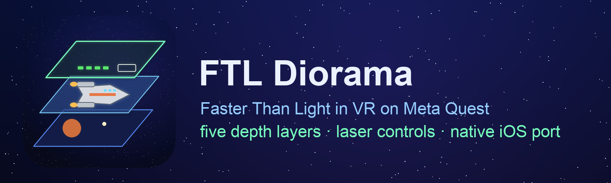
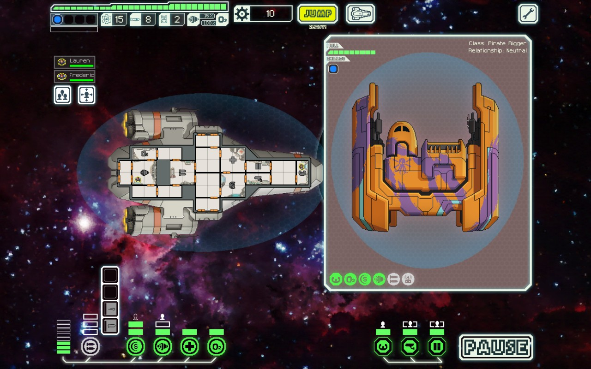
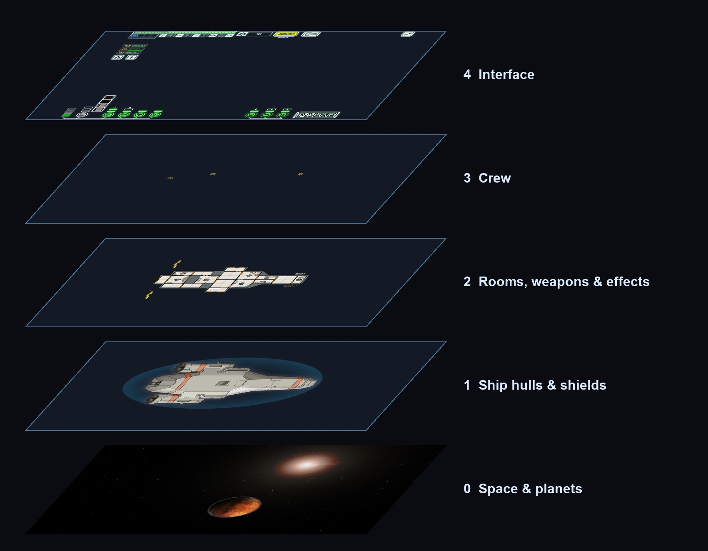

# FTL: Faster Than Light — Quest Diorama Edition

**Play FTL in VR as a 2.5D diorama.** This is an unofficial native port of the iOS version of *FTL: Faster Than Light* (1.6.21) to Meta Quest headsets. The game's frame is split into five depth layers and shown as stacked OpenXR panels: space at the back, ship hulls, rooms and weapons fire, crew, and the interface in front. Your ship floats over the starfield, crew walk a few centimetres above the deck plates, and the HUD hovers in front of it all.

The idea comes from the GBA diorama ports (WarioWare: Twisted!, Mother 3), applied to a full 2D strategy game.

[](https://youtu.be/0G6g1veP704)

▶ **[Watch the gameplay video](https://youtu.be/0G6g1veP704)**





> **You need your own copy of FTL for iOS.** This repository contains no game code, art or data. The APK is only a compatibility layer: it loads the original game binary and `ftl.dat` that you extract from your own iOS app.
> Not affiliated with or endorsed by Subset Games. FTL: Faster Than Light is © Subset Games.

---

## Features

- **Five-layer 3D diorama.** Choose 2D flat, 3D (6 cm between layers) or 3D deep (11 cm) at any time. Layers are perspective-matched, so the image lines up perfectly from your eyes.
- **Native speed, no emulation.** The original ARM64 iOS binary runs directly on the headset's CPU. A shim translates iOS (Darwin, UIKit, EAGL, Objective-C) to Android, EGL and OpenXR.
- **Immersive OpenXR app.** Five quad layers rendered straight from the game's own GL context, 60 or 120 Hz display (a clean cadence for FTL's 60 fps), sRGB-correct colours.
- **Laser-pointer controls.** Point and pull the trigger to tap. The pointer picks the layer you actually see under it, so buttons hit where they appear even with depth on.
- **Dedicated buttons** for pause, doors and system power, so you don't have to hunt for small icons mid-fight.
- **Grab and place.** Hold a grip to pick the game screen up and put it anywhere in your room.
- **Saves work.** Runs, profile and unlocks persist between sessions.

## Controls

| Input | Action |
| :--- | :--- |
| **Trigger** (either hand) | Laser click / drag (aim weapons, select and move crew, press buttons) |
| **A** | Pause / unpause |
| **Y** | Door controls |
| **Right stick up / down** while pointing at a system | Add / remove power |
| **Grip** (either hand, hold) | Grab the screen and move it around the room; stick pushes it away or pulls it closer |
| **Both sticks clicked together** | Cycle depth: 2D flat → 3D 6 cm → 3D deep 11 cm |
| **Right stick click** | Recenter the screen in front of you |
| **Left stick click** | Pause |

---

## Install

You need a Meta Quest headset with developer mode on (developed on Quest 3; Quest 2, 3S and Pro should work too) and your own copy of **FTL for iPad 1.6.21** as a decrypted `.ipa` (or a zip of `FTL.app`). Copies downloaded straight from the App Store are encrypted and won't run; the app checks this and tells you.

1. **Install the APK** from [Releases](../../releases) with SideQuest, or:
   ```bash
   adb install -r ftl-quest.apk
   ```
2. **Put your `.ipa` on the headset**, for example in the *Download* folder over USB.
3. **Launch FTL: Faster Than Light** from your library (also listed under *Unknown Sources*). On first launch a setup panel asks you to pick your `.ipa`. The app extracts the game executable and `ftl.dat` itself, then starts the game in VR.

Updating is just installing a newer APK over the old one; your game files and saves are kept.

<details><summary>Developer route (adb, no picker)</summary>

```bash
python3 tools/deploy_quest.py path/to/FTL.ipa   # extracts FTL + ftl.dat and pushes them to the headset
```
</details>

## Build from source

Requirements: Android SDK + NDK (via Android Studio), Gradle, Python 3, and a Mac or Linux shell.

```bash
./tools/fetch_openxr.sh          # Khronos OpenXR loader (Apache-2.0) -> deps/oxr
cd android && gradle assembleDebug
adb install -r app/build/outputs/apk/debug/app-debug.apk
```

On macOS, `./deploy_quest.command` builds, installs and launches in one step, using Android Studio's bundled JDK.

---

## How it works

- **Loader.** `macho_loader.cpp` maps the Mach-O binary into memory, binds its imports to shim implementations or Android libraries, and starts the game's own main loop.
- **iOS shim.** `darwin_abi.cpp`, `objc_shim.cpp` and friends cover Darwin ABI differences (stat, dirent, open/fcntl flags, `pthread_once`, `setjmp`), Apple's `std::string` layout, a minimal Objective-C runtime, UIKit touch delivery, EAGL → EGL, PVRTC texture decoding and audio.
- **Finding the scene.** A one-frame GL trace showed that FTL renders the whole scene into its own framebuffer, then copies it to the screen with one quad. The shim finds that framebuffer automatically and replays every draw into it a second time, into one of five layer textures.
- **Sorting draws into layers.** Every texture is tagged with the `ftl.dat` file it was loaded from, which works even with resource packs that change atlas sizes. The shim parses the archive index and matches each texture upload to the file it came from. The layer comes from the asset path: stars and planets, ship hulls, rooms and effects, crew sprites, or interface. Solid UI panels write a stencil, so crew portraits and icons drawn on top of them stay on the UI layer.
- **OpenXR.** `quest_xr.cpp` runs inside the game's own present call. It copies the five layer textures into OpenXR swapchains (premultiplied alpha, sRGB) and submits them as stacked quads, plus the laser beam and cursor.

Debug helpers: `adb shell touch /sdcard/Android/data/io.github.mrchrisster.ftlquest/files/.trace_frame` writes a one-frame GL trace to `trace.txt`, and `./capture_planes.command` pulls the current frame and all five layers as PNGs.

## Known limitations

- A few dynamically drawn effects may land on a neighbouring layer. Reports with a capture are welcome (`./capture_planes.command`).
- The power and door buttons tap the Kestrel-layout positions; ships with a different HUD layout may need adjusting.
- Hand tracking isn't supported yet; use controllers.
- Only FTL iOS 1.6.21 has been tested.

## Credits

- *FTL: Faster Than Light* by Subset Games. Buy it, it's wonderful.
- The diorama layering and OpenXR quad stack were inspired by the WarioWare: Twisted! and Mother 3 GBA recomp Quest ports.
- Logo: original artwork made for this port (`tools/branding/make_logo.py`).
- OpenXR loader © The Khronos Group (Apache-2.0), downloaded at build time.
