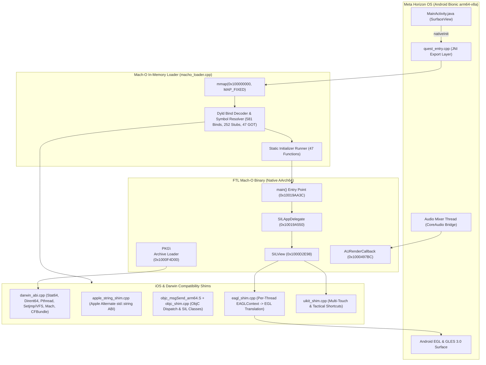
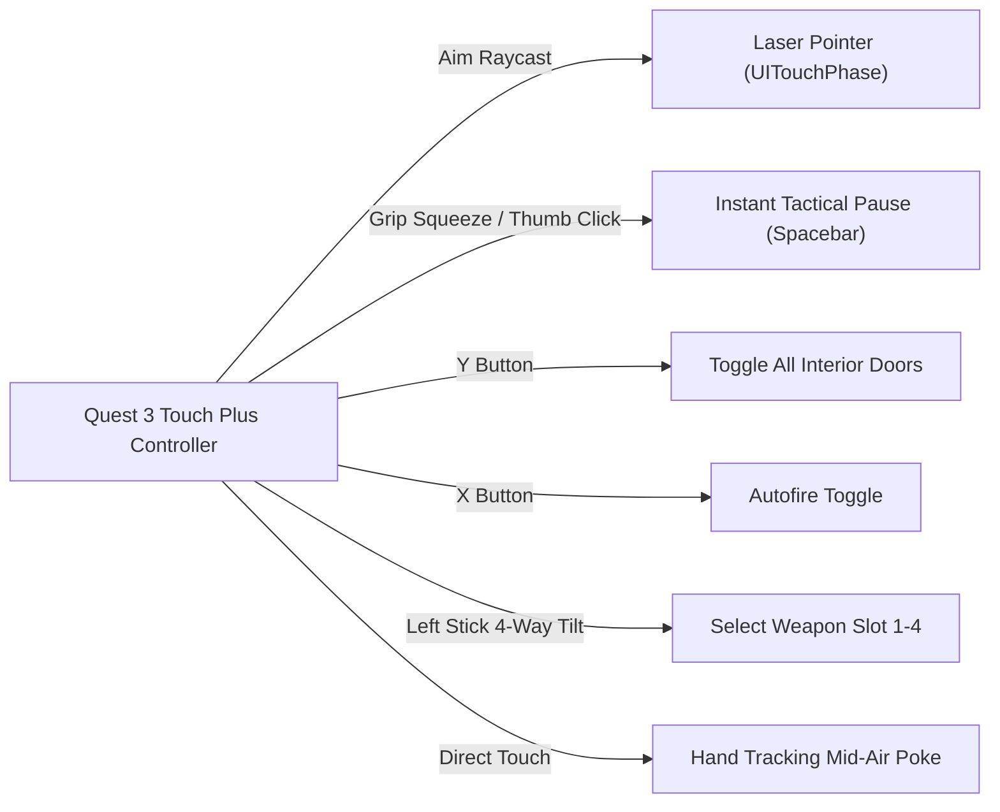

> Note: this document predates the immersive OpenXR diorama (see README, `shim/src/quest_xr.cpp`); the 2D-panel parts are historical.

# FTL: Quest 3 Port — Technical Architecture Specification

This document provides a comprehensive technical overview of the architecture used to port the ARM64 iOS build of ***FTL: Faster Than Light*** (v1.6.21) natively to **Meta Quest 3 (Android `arm64-v8a` / Meta Horizon OS)**.

---

## 1. System Topology & Execution Flow



---

## 2. Binary Ingestion & Memory Model

### 2.1 Universal Fat Slicing
The iOS IPA contains a Universal Fat binary (`0xCAFEBABE`) with two architectures:
- **Slice 0:** `ARMv7` (32-bit, `cryptid=1` / FairPlay encrypted).
- **Slice 1:** `ARM64` (64-bit, `cryptid=0` / unencrypted, offset `0x230000`, size `2,445,152` bytes).

Because Meta Quest 3 runs a 64-bit Qualcomm Snapdragon XR2 Gen 2 CPU (`arm64-v8a`), the ARM64 slice is 100% native AArch64 machine code. No instruction translation, dynamic recompilation, or JIT is required.

### 2.2 Memory Mapping (`MAP_FIXED`)
In 64-bit iOS, the executable is linked against base address `0x100000000` (4 GB boundary):
- `__TEXT` Segment: `0x100000000` to `0x10022C000` (`PROT_READ | PROT_EXEC`)
- `__DATA` Segment: `0x10022C000` to `0x10025C000` (`PROT_READ | PROT_WRITE`)

On 64-bit Linux / Android, virtual address space spans 48 bits (`0x000000000000` to `0x00007FFFFFFFFFFF`). The in-memory loader uses:
```c
void *base = mmap((void *)0x100000000, total_size, PROT_READ | PROT_WRITE, MAP_PRIVATE | MAP_ANONYMOUS | MAP_FIXED, -1, 0);
```
Because the binary is mapped at its exact link-time virtual address:
- **Zero Instruction Rewriting:** All internal PC-relative addressing (`ADRP` + `ADD`/`LDR`) resolves naturally.
- **Relocation Overhead Near Zero:** Only 20 internal pointer rebases exist in the entire executable.

---

## 3. Dynamic Symbol Resolution & Relinking

The binary uses `LC_DYLD_INFO_ONLY` opcode streams (`bind`, `weak_bind`, `lazy_bind`) alongside `__DATA,__got` (47 entries), `__DATA,__la_symbol_ptr` (252 lazy stubs), `__DATA,__nl_symbol_ptr`, and `__DATA,__cfstring`. In total, `macho_loader.cpp` applies **581 dyld binds** across internal segments and external imports, registers pointer indirections for `__cfstring` via `g_dummy_cfstring_ptrs`, binds `_OBJC_CLASS_$_*` / `_OBJC_METACLASS_$_*`, installs `dyld_stub_binder_trap` diagnostics, and calls `objc_register_macho_classes()` for the 8 Mach-O ObjC classes.

### 3.1 Standard Library & `libc++` ABI Bridging
- **Apple `std::__1::basic_string<char>` ABI Mismatch (`apple_string_shim.cpp`):** Apple ARM64 `libc++` compiles with `_LIBCPP_ABI_ALTERNATE_STRING_LAYOUT` (short-string length and flag live in byte 23 of the 24-byte SSO struct; long mode sets bit 7 of byte 23). Android NDK's `libc++_shared.so` uses `_LIBCPP_ABI_UNSTABLE` (short/long flag is bit 0 of byte 0). Routing Apple-compiled `std::__1::basic_string<char>` objects directly into `libc++_shared.so` caused immediate `SIGSEGV` (`0x0200000000000000`) during `mod_init[8]`. Therefore, all **19 external `std::__1::basic_string<char>` symbols** are intercepted by `apple_string_shim.cpp` using exact Apple SSO layout.
- **Remaining `libc++` Symbols:** Non-string `_ZNSt3__1...` symbols (such as `std::locale`, `iostream`, `mutex`, exception support) are dynamically translated (`St3__1` &rarr; `St6__ndk1`) and resolved from `libc++_shared.so`.
- **POSIX / C Lib:** String, math, memory, I/O, and threading functions resolve via Bionic `dlsym` or ABI wrappers in `darwin_abi.cpp`.
- **Zlib:** `inflate`, `inflateInit2_`, `inflateReset`, `inflateEnd` resolve against Android `libz.so`.

### 3.2 Darwin & Apple Platform Shims
Remaining platform imports and ObjC entry points are bridged by our shim layer (`darwin_abi.cpp`, `objc_msgSend_arm64.S`, `objc_shim.cpp`, `eagl_shim.cpp`):

#### A. Filesystem, Stat, Dirent & Open/Fcntl ABI (`darwin_abi.cpp`)
- **`stat` / `fstat` / `lstat` (`darwin_stat64`):** Darwin `st_mode` is at offset `+4` (16-bit); the binary reads `ldrh w8, [sp, #36]` after `BL _fstat`.
- **`open` / `fcntl` (`darwin_open`, `darwin_fcntl`):** Translates Darwin open flags (such as `O_CREAT`, `O_TRUNC`, `O_EXCL`, `O_NONBLOCK`, `O_APPEND`) and VFS paths to Linux/Bionic constants.
- **`opendir` / `readdir` / `closedir` (`darwin_opendir`, `darwin_readdir`):** Translates Bionic `struct dirent` into `darwin_dirent64` layout (`d_name` at offset `21` on Darwin vs `19` on Bionic).

#### B. Pthreads, `setjmp`/`longjmp`, `dlsym` & `sysconf` (`darwin_abi.cpp`, `objc_msgSend_arm64.S`)
- **`pthread_once` (`darwin_pthread_once`):** Apple defines `PTHREAD_ONCE_INIT` as `{0x30B1BCBA, {0}}` rather than zero. Passing a Darwin-initialized `pthread_once_t` to Bionic treats `0x30B1BCBA` as "already executed", silently skipping engine thread initialization; the wrapper normalizes Darwin's sentinel via atomic CAS.
- **`pthread_mutexattr_settype` (`darwin_pthread_mutexattr_settype`):** Darwin swaps mutex type constants relative to Bionic (`PTHREAD_MUTEX_ERRORCHECK=1`, `PTHREAD_MUTEX_RECURSIVE=2` on Darwin vs `NORMAL=0`, `RECURSIVE=1`, `ERRORCHECK=2` on Bionic). Static Darwin `PTHREAD_MUTEX_INITIALIZER` (`0x32AAABA7/8/9`) and `PTHREAD_COND_INITIALIZER` (`0x3CB0B1BB`) are lazily initialized.
- **`pthread_setname_np` / `pthread_key_create`:** Adapts Darwin's 1-argument `pthread_setname_np(const char*)` and zeros 64-bit `pthread_key_t` slots.
- **`setjmp` / `longjmp` (`darwin_setjmp`, `darwin_longjmp` in `objc_msgSend_arm64.S`):** Darwin ARM64 `jmp_buf` is **192 bytes** while Bionic's is **256 bytes** (`_JBLEN=32` longs). Calling Bionic `setjmp` directly would smash 64 bytes past stack-allocated Darwin buffers; custom AArch64 assembly saves/restores callee-saved GPRs, SP/LR, and `d8`-`d15` strictly within 192 bytes.
- **`dlsym` (`darwin_dlsym`) & `sysconf` (`darwin_sysconf`):** Translates Darwin `RTLD_DEFAULT (-2)` / `RTLD_NEXT (-1)` and Darwin `_SC_PAGESIZE (29)` to Android Bionic equivalents.
- **CoreFoundation (`CFBundleGetMainBundle`, `CFBundleGetInfoDictionary`):** Returns real bridged `NSBundle` and populated `NSMutableDictionary` objects instead of sentinel pointers.

#### C. Mach Timing & Semaphores (`darwin_abi.cpp`)
- `mach_absolute_time()` maps to `clock_gettime(CLOCK_MONOTONIC)`.
- `mach_timebase_info()` returns `numer=1, denom=1` (1 tick = 1 nanosecond).
- `semaphore_create`, `wait`, `signal`, `destroy` wrap POSIX `sem_t`.

#### D. ARM64 Math & ObjC Dispatch Calling Conventions
- **`___sincosf_stret`:** Returns `sinf`/`cosf` packed in `s0` and `s1`.
- **`objc_msgSend` (`objc_msgSend_arm64.S`):** Forwards `caller_lr` (`mov x2, x30`) to `objc_lookup_imp_for_send`, validates `self`/`isa` (`>= 0x100000`), and deduplicates unhandled selector telemetry.

---

## 4. Subset iOS Layer ("SIL") & Runtime Architecture

FTL implements a custom platform abstraction layer prefixed with `SIL`:
- **`SILAppDelegate`:** Registered with `UIApplicationMain`. When launched, calls `application:didFinishLaunchingWithOptions:` (`0x10019A550`) to spawn engine threads and build the window.
- **`SILViewController`:** Fullscreen orientation controller.
- **`SILView`:** `CAEAGLLayer`-backed view handling OpenGL ES initialization, swap buffers, and multi-touch events.

### 4.1 Graphics Pipeline (`eagl_shim.cpp`)
1. FTL invokes `-[SILView createGLContext:withLayer:]` (`0x1000D3734`), allocating an `EAGLContext` with API `kEAGLRenderingAPIOpenGLES3` (`3`).
2. `eagl_shim.cpp` maps this to the Android `EGL` display/context initialized with `EGL_CONTEXT_CLIENT_VERSION = 3` and maintains current `EAGLContextRef` in thread-local storage (`__thread EAGLContextRef g_tls_eagl_context`) so short-lived background loader threads unbinding `[EAGLContext setCurrentContext:nil]` do not clobber the main render thread's active context.
3. Optional GL 4.5 DSA probes (e.g., `_glCreateTextures`, `_glTextureStorage2D`) during SIL GL initialization remain unresolved and fall back to standard GLES3 paths.
4. FTL calls `-[SILView present]` (`0x1000D3A60`), which invokes `[context presentRenderbuffer:GL_RENDERBUFFER]`.
5. `eagl_present_renderbuffer()` translates this to `eglSwapBuffers(display, surface)`.

### 4.2 Audio Pipeline (`darwin_abi.cpp`)
1. FTL initializes AudioToolbox RemoteIO and registers an `AURenderCallback` function pointer at **`0x1000497BC`** via `AudioUnitSetProperty(kAudioUnitProperty_SetRenderCallback)`.
2. FTL calls `AudioOutputUnitStart()`.
3. Our shim spawns a dedicated high-priority audio worker thread running at 44.1 kHz.
4. The worker thread calls `0x1000497BC(refCon, NULL, NULL, 0, 512, &bufList)` to pull mixed 16-bit stereo PCM audio directly from FTL's internal sound engine.

---

## 5. Virtual File System & Asset Mounting

- **Package Format:** The file `ftl.dat` (231.18 MB) uses Subset Games' `PKG\n` big-endian package format containing 1,829 files.
- **Archive Loader:** The internal parser is located at `0x1000F4D00`. It checks magic `0x0A474B50` (`"PKG\n"`), reads the file index table, and opens sub-files via internal descriptors.
- **Redirection:** `darwin_vfs_resolve()` transparently routes `"ftl.dat"` and `".app/"` lookups to `/sdcard/Android/data/com.subsetgames.ftl/files/` and save files (`prof.sav`, `ae_prof.sav`, `settings.ini`) to internal storage `/save/`.

---

## 6. Meta Quest 3 Spatial Controller Architecture



### 6.1 Multi-Touch Emulation
Quest 3 controller laser pointers and hand-tracking rays produce Android `MotionEvent`s. `MainActivity.java` forwards coordinates and pointer IDs to `quest_inject_touch()`, which packages them into emulated `UITouch` and `NSSet` objects dispatched to `-[SILView touchesBegan:withEvent:]`, `touchesMoved:`, and `touchesEnded:`.

### 6.2 Tactical Hotkeys
To eliminate the friction of pointing at corner buttons during combat, `uikit_shim.cpp` injects synthetic tactical taps:
- **Grip Trigger / Left Stick Click:** Emulates both a tap on the top-left pause button `(40, 35)` and the iPad two-finger tap gesture.
- **Y Button:** Toggles all interior doors `(980, 165)` / `(980, 220)`.
- **X Button:** Toggles weapon autofire `(80, 715)`.
- **Thumbstick 4-Way Tilt:** Instantly activates weapon slots 1, 2, 3, or 4.
